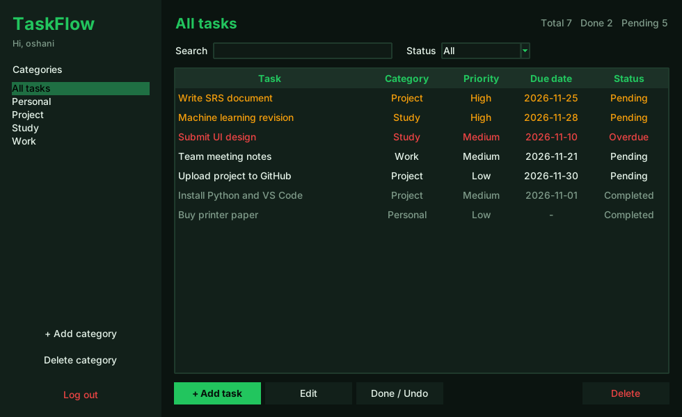
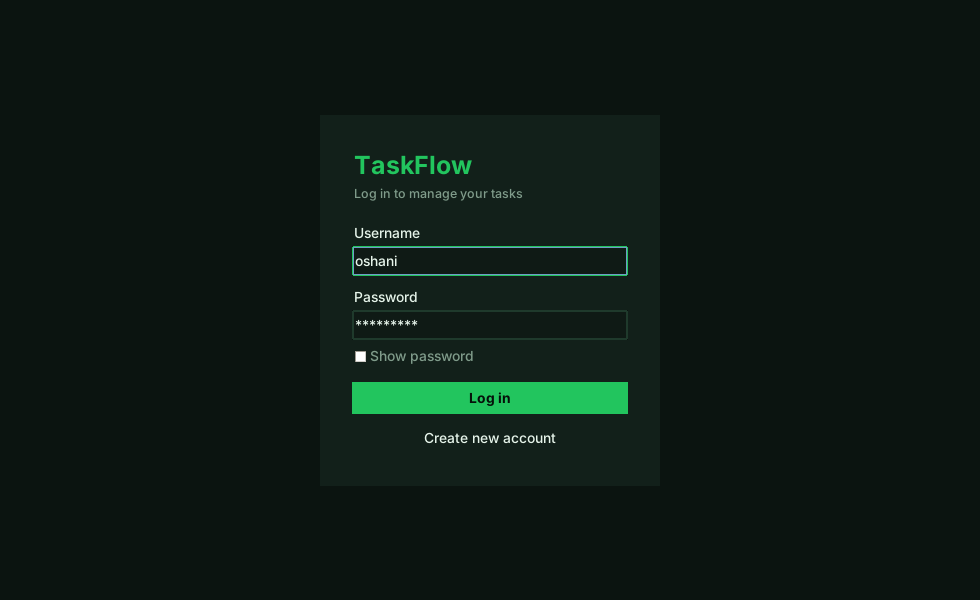
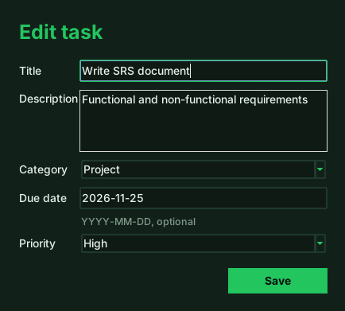
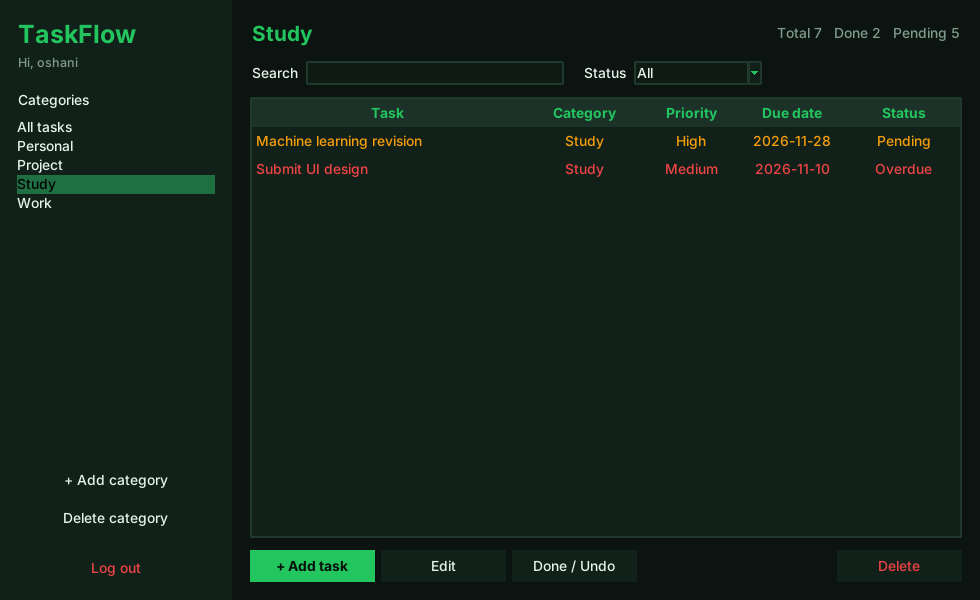
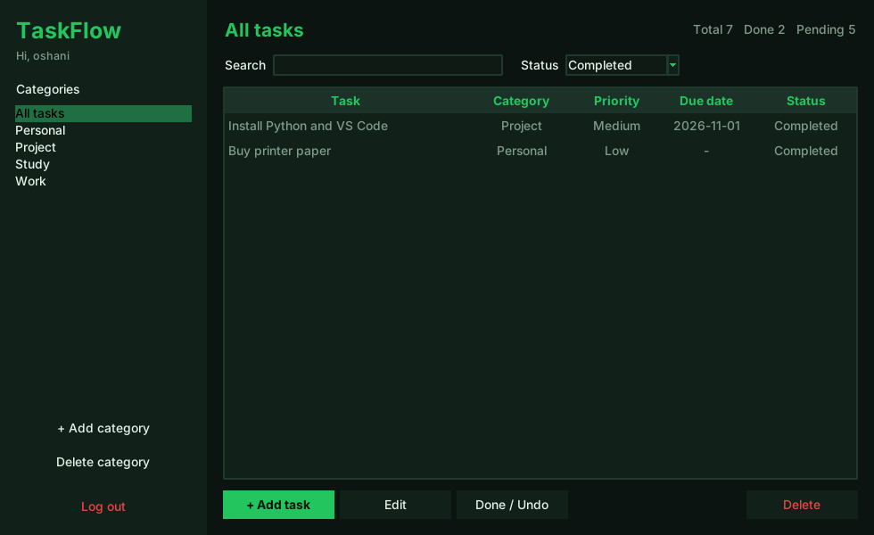

# TaskFlow

A simple desktop task manager built with **Python**, **Tkinter** and **SQLite**.

Users can create an account, sort their tasks into categories, set priorities and due dates, and quickly see what is pending, completed or overdue.



## Features

- **Login and sign up** — passwords are stored as salted SHA-256 hashes, never as plain text
- **Categories** — every user starts with Study, Work and Personal, and can add or delete their own
- **Tasks** — add, edit, delete and mark tasks as done, with a title, description, category, priority and due date
- **Search and filters** — search as you type, and filter by category or status
- **Colour hints** — high-priority tasks are orange, overdue tasks are red and completed tasks are greyed out
- **Tests** — unit tests for the database and the input checks

## Screenshots

| Login | Edit task |
|:---:|:---:|
|  |  |

| Category filter | Completed tasks |
|:---:|:---:|
|  |  |

## How to run

You only need Python 3 — Tkinter and SQLite come with it.

```bash
python main.py
```

The database file (`database.db`) is created automatically the first time you run the app. Click **Create new account** to sign up.

To run the tests:

```bash
python -m unittest test_app.py
```

## Project structure

```
├── main.py          # the app windows: login, dashboard and task form
├── database.py      # all SQLite code (users, categories, tasks)
├── validation.py    # checks for usernames, passwords, tasks and categories
├── test_app.py      # unit tests
└── screenshots/     # pictures used in this README
```

## Author

**Oshani Hind Elgiriyage** — BSc Computer Science & Artificial Intelligence, NIBM KIC

## License

Copyright © 2026 Oshani Hind Elgiriyage. All rights reserved.
